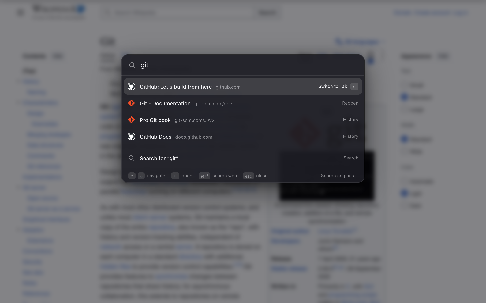

<p align="center">
  
</p>

<h1 align="center">Jumpbar</h1>

<p align="center">
  An Arc-style command palette for Chrome and Brave.<br />
  Jump to any tab, reopen closed ones, open sites, or search the web, all from the keyboard.
</p>

---

<p align="center">
  
</p>

## Features

- **Floating palette** over a dimmed, blurred page. Opens with <kbd>Cmd</kbd>+<kbd>K</kbd> (<kbd>Ctrl</kbd>+<kbd>K</kbd> on Windows/Linux).
- **Fast tab switching.** The current tab is never listed, so <kbd>Cmd</kbd>+<kbd>K</kbd>, <kbd>Enter</kbd> jumps back to the previous tab.
- **One search box for everything**, in this priority order:
  1. open tabs
  2. recently closed tabs
  3. bookmarks
  4. browsing history
- **Fuzzy matching.** Typing `ghub` finds GitHub. Loose matches only appear when nothing matches exactly. Exact and word-start matches rank first, and history is ordered by how often and how recently you visit a page.
- **Open sites directly.** Type `www.example.com`, `https://…` or `example.com` and press <kbd>Enter</kbd>.
- **Web search always one keystroke away.** A "Search for…" row stays pinned below the results, and <kbd>Cmd</kbd>+<kbd>Enter</kbd> searches the web even when tabs match. Results are capped at 10.
- **`?` prefix.** Start with `?` (for example `? best pizza`) to skip your tabs and history and search the web directly.
- **Personal search engines.** Define a shortcut like `yt`, type it, press <kbd>Tab</kbd>, and a badge appears. Whatever you type next is sent to that site's search.
- Follows light and dark mode and respects reduced motion.

## Install

Jumpbar isn't on a web store yet, so load it unpacked:

1. Clone this repo.
2. Open `chrome://extensions` (Chrome) or `brave://extensions` (Brave).
3. Turn on **Developer mode**.
4. Click **Load unpacked** and select this folder.

No build step and no dependencies.

## Usage

| Key | Action |
| --- | --- |
| <kbd>Cmd</kbd>+<kbd>K</kbd> (<kbd>Ctrl</kbd>+<kbd>K</kbd> on Windows/Linux) | Open / close the palette |
| <kbd>↑</kbd> <kbd>↓</kbd>, <kbd>Tab</kbd> (macOS also <kbd>Ctrl</kbd>+<kbd>N</kbd>/<kbd>P</kbd>) | Move the selection |
| <kbd>Enter</kbd> | Open the selected item |
| <kbd>Cmd</kbd>+<kbd>Enter</kbd> (<kbd>Ctrl</kbd>+<kbd>Enter</kbd> on Windows/Linux) | Search the web with your default engine |
| <kbd>Cmd</kbd>+<kbd>Backspace</kbd> on an open tab or history item | Close the tab / delete the page from your history |
| <kbd>Cmd</kbd>+<kbd>C</kbd> / <kbd>Cmd</kbd>+<kbd>Shift</kbd>+<kbd>C</kbd> | Copy the selected result's URL / the current page's URL |
| <kbd>Esc</kbd> | Clear the input; close when it's already empty |
| <kbd>Tab</kbd> after a shortcut | Enter that search engine's mode |
| <kbd>Backspace</kbd> on an empty input | Leave search engine mode |

Clicking the toolbar icon opens the palette too.

### Personal search engines

Open the settings page (right-click the toolbar icon → *Options*, or **Search engines…** in the palette footer) and add an engine:

| Field | Example |
| --- | --- |
| Name | `YouTube` |
| Shortcut | `yt` |
| URL with `%s` in place of the query | `https://www.youtube.com/results?search_query=%s` |

Then in the palette: type `yt`, press <kbd>Tab</kbd>, type `lofi beats`, press <kbd>Enter</kbd>. The query is URL-encoded and substituted for `%s`. Only `https` URLs are accepted. Engines are stored in `chrome.storage.sync`.

Use **Export…** / **Import…** on the settings page to back up engines or move them to another browser. Imports are validated like the form, and engines whose shortcut already exists are skipped.

### Private windows

If you've allowed Jumpbar in Incognito, it keeps private and regular browsing separate by default: regular windows never show private tabs, and a private window only shows its own tabs. Tick **Include tabs across private and regular windows** in the settings page to mix them.

### Changing the shortcut

Go to `chrome://extensions/shortcuts` (`brave://extensions/shortcuts`) and rebind **Open the search palette**.

Jumpbar needs Chrome 130 or newer. Some sites (Slack, GitHub, Notion…) use <kbd>Cmd</kbd>+<kbd>K</kbd> themselves; Jumpbar takes precedence, so rebind it if you prefer theirs.

The overlay can't be injected into `chrome://` pages, the Web Store or the built-in PDF viewer. On those pages, <kbd>Cmd</kbd>+<kbd>K</kbd> does nothing.

## Permissions

| Permission | Why |
| --- | --- |
| `tabs` | List and switch between open tabs |
| `sessions` | List and restore recently closed tabs |
| `bookmarks` | Search bookmarks |
| `history` | Search browsing history |
| `search` | Run a search with your default search engine |
| `favicon` | Show site icons in results |
| `storage` | Save your search engines |
| `activeTab` + `scripting` | Show the overlay on the page you open it from. Jumpbar only runs on a page when you press the shortcut or click the toolbar icon |

Jumpbar doesn't make network requests and doesn't collect or send any data. See [PRIVACY.md](PRIVACY.md).

## Project structure

```
manifest.json     Manifest V3 config, shortcut, permissions
background.js     Service worker: search across tabs/closed/history, tab actions
palette.js        The palette UI (shadow DOM), mounted as an overlay
content.js        Mounts the overlay on web pages
options.html / .js  Search engine settings
scripts/pack.sh    Builds the zip for the Web Store
PRIVACY.md        Privacy policy
STORE_LISTING.md  Chrome Web Store listing text and form answers
icons/            Logo (SVG source and PNG sizes)
```

## Publishing to the Chrome Web Store

1. Bump `version` in `manifest.json` (the store rejects an upload with a version it already has).
2. Run `./scripts/pack.sh`. It writes `dist/jumpbar-<version>.zip` with only the files the extension needs (no docs, screenshots or git data).
3. Optional check: unzip it somewhere, then load that folder via **Load unpacked** and try the shortcut.
4. In the [Developer Dashboard](https://chrome.google.com/webstore/devconsole), create a new item (or open the existing one → **Package** → **Upload new package**) and upload the zip.
5. Fill in the listing, privacy and distribution tabs using [STORE_LISTING.md](STORE_LISTING.md), and upload the images from `store/`.
6. **Submit for review.** Reviews usually take from a few days up to a couple of weeks for a first submission.

## Development

There is nothing to build. Edit the files, then press the reload button on the extension's card in `chrome://extensions`. Reload open pages to pick up content script changes.
